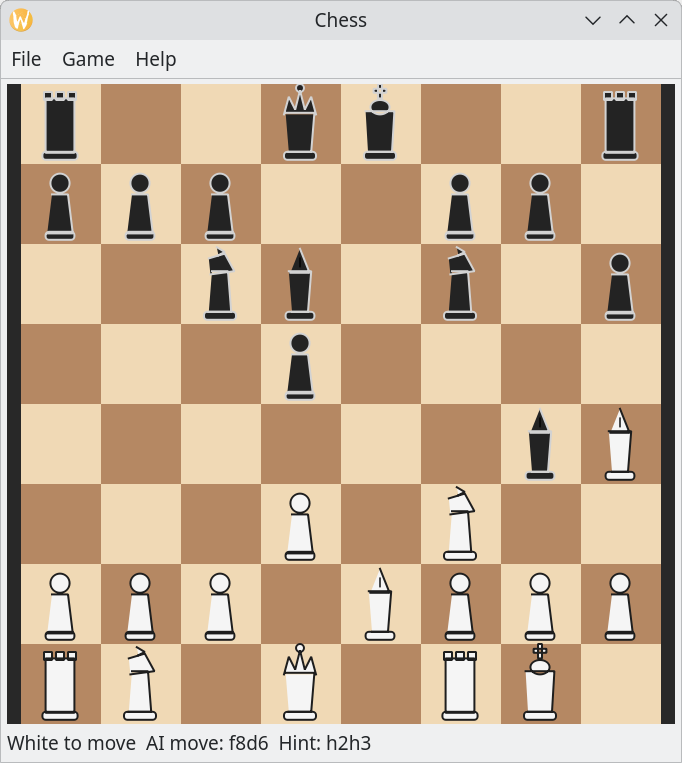

# Chess

A chess game with a minimax AI opponent using alpha-beta pruning built with C++ and Qt 6.

A screenshot of the Chess game running on a Debian 13 KDE (Wayland) is shown below. 



## Features

- 8×8 chessboard with the standard 32-piece starting position
- Two-player chess game or enable the minimax AI to play Black
- Click a piece to select it and highlight its legal moves
- Click a highlighted square to move
- Alternating turns, check and checkmate detection, and stalemate detection
- Pawn promotion to a queen
- Castling and en passant
- Status label showing the current game state
- Optional Black AI using minimax with alpha-beta pruning
- AI search runs outside the GUI thread
- Undo the last turn and print move history
- Hint feature to suggest next best move for the side to move (useful when playing AI but do not rely on it)
- Reset the game with **R**

## Chess

Chess is a strategy game for two players, White and Black. Players take turns moving one piece at a time. The aim is to checkmate the opposing king: attack it so that it is in check and has no legal move to escape.

Each piece moves differently:

- **Pawn:** Usually moves forward one square, captures diagonally, and may move two squares on its first move. A pawn that reaches the far side of the board is promoted; this game promotes it to a queen.
- **Knight:** Moves in an L-shape and can jump over other pieces.
- **Bishop:** Moves diagonally.
- **Rook:** Moves horizontally or vertically.
- **Queen:** Moves horizontally, vertically, or diagonally.
- **King:** Moves one square in any direction. The king may also castle under the required conditions.

A player may not make a move that leaves their own king in check. If the player to move is not in check but has no legal moves, the game is a stalemate.

## How to play

1. Start the application. The game begins with White to move.
2. Click one of your pieces. Its legal destination squares are highlighted.
3. Click a highlighted square to make the move.
4. Players alternate turns. Follow the status label for whose turn it is and whether a king is in check.
5. To start a new game, press **R** or choose **Game → New Game**.
6. To undo the last turn, press **Z** or choose **Game → Undo Last Turn**.
7. To play against the computer, choose **Game → AI Plays Black**. The AI plays Black, so the human plays White.

The AI depth is set to 4 but can be increased. Greater search depth can make the AI take longer to choose a move.

## Running Chess Game Using Pre-built Binary

A pre-built binary of the latest version of the Chess game for x86 Linux computers and can be downloaded from the binary directory and has been tested using Debian 13 Trixie KDE. Once downloaded and unzipped make sure that Chess has executable permissions before running. To change permissions and run Chess from the terminal use the commands below.
```
chmod +x chess
./chess
```

### GNOME/Ubuntu Desktops

You may have to install the Qt 6 base libraries on Debian GNOME, Fedora GNOME, Ubuntu GNOME and other GTK based distributions.

With Debian GNOME and  Ubuntu 26.04 you need to install the the adwaita-qt6 theme engine and Qt runtime libraries to run Chess as shown below.
```
sudo apt install adwaita-qt6
sudo apt install qt6-base-dev 
```

## Desktop File

A desktop file has a .desktop extension and provides metadata about an application such as its name, icon, command to execute and other properties. A "chess.desktop" file is shown below. You need to modify this by using your own user name and directory locations. In this example it is assumed that local applications are installed in a folder called Software (/home/your_user_name/Software). Some people use a folder called "Programs". The Exec variable defines the command to execute when launching an application, in this case, the "chess" binary executable. In a .desktop file, you need to use absolute and full paths.

```
[Desktop Entry]
Version=0.1.0
Type=Application
Name=Chess
Comment=Chess Game
Exec=/home/your_user_name/Software/chess/chess
Path=/home/your_user_name/Software/chess
Categories=Game;
StartupNotify=true
Name[en_GB]=Chess
```

To install the chess game locally copy the  "chess.desktop" file into in the ***~/.local/share/applications/***  directory. If the applications directory does not exist create it. You will need to modify the desktop file so that it uses your user name and the directory where you install local programs. To
copy your modified  "chess.desktop" file to ***~/.local/share/applications/*** you can use your graphical file manager or the terminal command below.

```
cp chess.desktop /home/your_user_name/.local/share/applications
```

Again change "your_user_name" to your user name. Note that ***.local*** is a hidden directory and you need to tick the "Show Hidden Files" option in the file explorer to display it.

You can now run chess from the system menu. It should be located in the "Game Category". 


## Chess Project Code Structure

The code files are shown below.

```text
chess/
├── compile-and-run.sh		# BASH script
├── CMakeLists.txt         
├── chessposition.h          
├── chessposition.cpp       # the board and state required to represent a position
├── chessengine.h           
├── chessengine.cpp         # rules and search operations that work on a position
├── chessboardwidget.h
├── chessboardwidget.cpp    # widget-specific code: drawing & interaction
├── mainwindow.h
├── mainwindow.cpp
└── main.cpp                  # Application entry point
```

The board rules, drawing, and mouse interaction are contained in `ChessBoardWidget`. 

## Core files

### `chessposition.h` and `chessposition.cpp`

The ChessPosition class (written using pure C++) defines the board and state required to represent a chess position including castling rights and en-passant target. The core types are shown below.
```
enum class Color
{
    White,
    Black
};

enum class PieceType
{
    None,
    Pawn,
    Knight,
    Bishop,
    Rook,
    Queen,
    King
};

struct Piece
{
    Color color = Color::White;
    PieceType type = PieceType::None;

    bool isEmpty() const
    {
        return type == PieceType::None;
    }
};

struct Move
{
    int fromRow = 0;
    int fromCol = 0;
    int toRow = 0;
    int toCol = 0;
};

struct Square
{
    int row = -1;
    int col = -1;

    bool isInvalid() const
    {
        return row < 0 || col < 0;
    }
};
```

The board is declared using the Piece structure.
```
Piece board[8][8]{};
```
These types are accessible to the ChessEngine and ChessBoardWidget classes.

### `chessengine.h` and `chessengine.cpp`

The ChessEngine class (written using pure C++) incorporates the rules and search operations that work on a position: legal move generation, check detection, move application/undo, evaluation, and minimax. The AI search runs in its own thread. 

Because chess position and chess engine classes have been written using pure C++ they provide a portable core.

### `chessboardwidget.h` and `chessboardwidget.cpp`

The ChessBoardWidget class contains widget-specific code. Its responsibilities are drawing, mouse/keyboard input, status text, move history UI, undo UI, AI thread scheduling and applying AI results back onto the GUI thread. In C++, std::promise and std::future let one thread deliver a result (or exception) to another. A std::promise<T> is the producer: it sets a value or an exception. A std::future<T> is the consumer’s handle to that result.

The GUI thread owns the ChessBoardWidget. The worker thread owns only a copied ChessPosition. The AI thread is started in:

```
void ChessBoardWidget::maybeScheduleAiMove()
```

This function:

- checks whether the AI should move
- copies the current position
- creates a `std::promise`
- starts a `std::thread`
- calls `pollAiResult()`

The worker thread then runs:

```
Move best = ChessEngine::findBestMove(snapshot, color, depth);
promise.set_value(best);
```
The GUI thread checks for the result in:

```
void ChessBoardWidget::pollAiResult()
```

The pollAiResult() function:

- checks whether the future is ready
- if not ready, schedules another check with QTimer
- if ready, joins the thread
- reads the result with future.get()
- applies the move back on the GUI thread

So the split is:

```text
GUI thread:
    maybeScheduleAiMove()
    pollAiResult()
    executeMove()
    paint/update

Worker thread:
    ChessEngine::findBestMove()
    minimax()
    promise.set_value()
```

The std::promise and std::future can be thought of as a one-way mailbox. The worker thread writes the answer. The GUI later reads the answer. The worker never touches the widget. 

The ownership diagram is shown below.
```
GUI thread
├── ChessBoardWidget
│   ├── position                // live game position
│   ├── moveHistory
│   ├── undoStack
│   ├── positionCounts
│   ├── aiFuture                // reads AI result
│   ├── aiThread
│   └── pollAiResult()          // checks future and applies move
│
└── QTimer
    └── schedules pollAiResult()

Worker thread
├── snapshot                    // copied position
├── ChessEngine::findBestMove()
├── minimax()
└── promise.set_value(bestMove) // writes result
```

The only communication channel.
```
worker: promise.set_value(move)
GUI:    future.get()
```

The worker thread uses a ChessPosition snapshot using the line below.
```
ChessPosition snapshot = position;
```
It copies the live position. Then the worker searches:
```
ChessEngine::findBestMove(snapshot, color, depth)
```
If the GUI changes the live position while the worker is running, it does not affect the worker because the worker is using its own copy. Because the GUI thread is separate from the AI search thread data races and corrupt positions are prevented.

### `mainwindow.h` and `mainwindow.cpp`

The `MainWindow` class creates the application window and talks to the public chessboard widget API. In the current implementation, it places the board and a status label in a vertical layout, creates the **File**, **Game**, and **Help** menus, and connects menu actions to the chessboard or window.The menu actions include quitting, starting a new game, toggling the Black AI, printing move history, undoing the last turn, and opening the information dialog. The status callback from `ChessBoardWidget` class updates the message label in the main window.

## Building and running

These instructions are for Debian 13 based systems. Install the C++ build tools, CMake, and Qt 6 development packages:

```bash
sudo apt update
sudo apt install build-essential cmake qt6-base-dev qt6-base-dev-tools
```

Once the Qt 6 development environment has been installed you can use the compile-and-run.sh BASH script to build and run the chess project. From the project’s root directory, make the script executable and run it:

```bash
chmod +x compile-and-run.sh
./compile-and-run.sh
```

The script removes and recreates the `build` directory before building. To run the executable again without rebuilding, run it from the build directory:

```bash
cd build
./chess
```

You can also build manually from the project root:

```bash
mkdir build
cd build
cmake ..
make
./chess
```

This is a typical build workflow for a CMake-based project. 
 

## Notes

The Chess game has piece movement, captures, check, checkmate, stalemate, castling, en passant, pawn promotion to queen, legal move filtering, threefold repetition, undo and AI opponent. However, it lacks advanced engine features such as  quiescence search, iterative deepening, opening book and endgame tables. I will attempt to implement some of these features in later versions..

## License

Distributed under the **[GPL-2.0-or-later](https://www.gnu.org/licenses/old-licenses/gpl-2.0.html)**.


## Author

* **Alan Crispin** [Github](https://github.com/crispinprojects)


## Project Status

Active.

## Acknowledgements

* [Debian](https://www.debian.org/)

* [Qt](https://doc.qt.io/)

